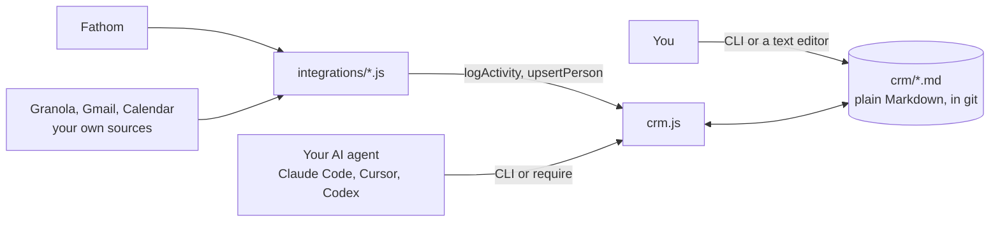

<p align="center"><a href="https://pumpgtm.com"></a></p>

<h1 align="center">PumpGTM OpenCRM</h1>

<p align="center"><b>A CRM your AI agent can run. One file, plain Markdown, no database.</b><br>
Accounts, people, activities, tasks and agreements, each stored as a Markdown file you can read, edit, grep and commit. One JavaScript file is the CLI and the API. It's the model we ran our own sales pipeline on, cut down to the fields we actually filled in.</p>

<p align="center">
<a href="crm.js"></a>
<a href="crm.js"></a>
<a href="https://nodejs.org"></a>
<a href="SCHEMA.md"></a>
<a href="https://pumpgtm.com/yc"></a>
<a href="LICENSE"></a>
</p>

<p align="center">
<a href="#quickstart">Quickstart</a> · <a href="SCHEMA.md">Schema</a> · <a href="skills/opencrm/SKILL.md">Agent skill</a> · <a href="#add-a-source">Add a source</a> · <a href="https://pumpgtm.com">pumpgtm.com</a> · <a href="https://www.youtube.com/@pumpgtm">YouTube</a>
</p>

## Why

A call ends with "send them the security doc by Thursday." That next step lives in your head, or in
a date typed into a notes field that someone overwrites next week. Two weeks later the deal is cold
and nobody can say why.

OpenCRM makes three things true:

- **Every next step is a task** with a due date. "Next follow-up" is computed from open tasks, so it
  can't go stale.
- **Facts and judgement stay separate.** Syncs from Fathom, Gmail or your calendar log what happened.
  Only a person (or an agent you told to) moves a deal's stage.
- **Re-running anything is safe.** Every activity carries its source id, so the same call or email is
  never logged twice.

It's files, so any agent that can run a shell command can use it: Claude Code, Cursor, Codex, or your
own script. No server, no account, no lock-in.

## How it fits together



## Quickstart

```bash
curl -O https://raw.githubusercontent.com/pumpgtm/pumpgtm-ai-opencrm/main/crm.js
node crm.js init
node crm.js account Acme source=Inbound domain=acme.com stage=Discovery
node crm.js person jane@acme.com name="Jane Doe" account=Acme channel=LinkedIn
node crm.js activity "Discovery call" account=Acme type=Meeting attendees=jane@acme.com note="Wants SSO first."
node crm.js task create "Send SSO doc" account=Acme due=2026-10-02 type=Email
node crm.js show Acme
```

```
# Acme  Discovery · Inbound · acme.com
last contact 2026-10-01 · next follow-up 2026-10-02

people
  Jane Doe <jane@acme.com>
tasks
  2026-10-02  Open  Acme  Send SSO doc
activities
  2026-10-01  Meeting  Discovery call
agreements
  none
```

Every record is a file you can open:

```markdown
---
name: Discovery call
type: Meeting
date: 2026-10-01
account: Acme
attendees: [jane@acme.com]
source: fathom
source_id: 123456789
url: https://fathom.video/share/...
---

## Meeting Purpose
Wants SSO before a pilot. Security review is the gate.
```

Keep the data anywhere with `CRM_DIR=~/sales/crm`. Add `--json` to any command for machine output.

## Give it to your agent

Copy [`skills/opencrm/SKILL.md`](skills/opencrm/SKILL.md) into your agent's skills folder (for Claude
Code, `.claude/skills/opencrm/`). It holds the eight operating rules and the exact commands for after
a call, after a reply, daily review, and signed paper. Or tell your agent:

> Read SKILL.md and SCHEMA.md in pumpgtm-ai-opencrm, then log today's calls and give me what's due.

## Commands

| command | does |
|---|---|
| `init` | create `crm/` and `crm/schema.json` |
| `account "<Name>" [stage= source= domain= note=]` | create or update an account. `note=` appends to the body |
| `person <email\|-> [name= account= status= channel= linkedin= note=]` | create or update a person |
| `activity "<Title>" [account= type= date= attendees= source= source_id= url= note=]` | log something that happened. Prints `exists` if that source id is already logged |
| `task create "<Title>" account= [due= status= type= person= note=]` | add a next step |
| `task done\|skip\|snooze\|set account= title=<substring>` | close, drop, move or edit an open task |
| `agreement create "<Title>" account= type= [status= fee= effective= next= signer= ref=]` | record signed paper or an invoice |
| `agreement set account= title=<substring> [...]` | update one |
| `show "<Name>"` | the account with its people, activities, tasks, agreements, last contact, next follow-up |
| `pipeline` | live deals, most neglected first |
| `due` | open and waiting tasks, soonest first |
| `list <kind> [field=value ...]` | filter any record type |
| `validate` | schema errors, plus live deals with no next step |

Writes are strict. Unknown fields, values that aren't allowed, bad dates, and accounts that don't exist
are all rejected before anything is written. The fields and values are in [SCHEMA.md](SCHEMA.md), and
`crm/schema.json` lets you change them.

## Use it as a library

```js
const crm = require("./crm");
crm.setRoot("./crm");

crm.upsertAccount("Acme", { stage: "Scoping", note: "Security review is the gate." });
crm.logActivity("Re: pricing", { account: "Acme", type: "Email", source: "gmail", source_id: "18c2f" });
crm.createTask("Send pricing", { account: "Acme", due: "2026-10-02" });
crm.updateTask("Acme", "pricing", { status: "Done" });

crm.accountView("Acme");          // account + people, activities, tasks, agreements, last_contact, next_followup
crm.accountForEmail("j@acme.com"); // the account whose domain matches
crm.pipeline();                   // live deals, most neglected first
crm.due();                        // open and waiting tasks
crm.validate();                   // [] when clean
```

## Add a source

A source is a short script that reads a tool and calls two functions. Use the tool's own id as
`source_id`, and syncing becomes safe to run on a schedule.

```js
crm.upsertPerson(email, { name, account: crm.accountForEmail(email)?.name });
crm.logActivity(title, { date, type: "Meeting", attendees, source: "granola", source_id: id, url, note: summary });
```

Shipped, and tested against the live Fathom API:

```bash
FATHOM_API_KEY=... node integrations/fathom.js --since=2026-09-20
# fathom: 35 logged, 0 already in the CRM
# second run: fathom: 0 logged, 35 already in the CRM
```

[`integrations/fathom.js`](integrations/fathom.js) is under 60 lines and handles paging and rate limits. Copy
it for Granola, Gmail, Google Calendar or anything else. A source logs facts only. It never sets a
stage or writes account notes.

## Watch and read

<table>
<tr>
<td width="50%" align="center"><a href="https://www.youtube.com/watch?v=wEb9ZDUIsc0"></a><br><sub><b>What is PumpGTM? 3 reasons it's the best GTM automation tool</b><br>2 minutes</sub></td>
<td width="50%" align="center"><a href="https://www.youtube.com/watch?v=jYiB39fBCZ8"></a><br><sub><b>Cold email alone won't get you customers (multi-channel outbound)</b><br>2 minutes</sub></td>
</tr>
<tr>
<td width="50%" align="center"><a href="https://www.youtube.com/watch?v=fUM3uCckPEk"></a><br><sub><b>How to write a cold message that gets replies: 3 rules from 10+ YC startups</b><br>2 minutes</sub></td>
<td width="50%" align="center"><a href="https://x.com/NamanyayG/article/2097783972302557668"></a><br><sub><b>Using AI to run founder-led outbound for 10 YC companies</b><br>Namanyay's article on X. <a href="https://pumpgtm.com/blog/ai-founder-led-outbound-system">Read on pumpgtm.com</a></sub></td>
</tr>
</table>

More on the [PumpGTM YouTube channel](https://www.youtube.com/@pumpgtm), including [Supermemory's founder on finding the right leads](https://www.youtube.com/watch?v=D5eE3qqevmQ).

## Filling the CRM

OpenCRM keeps track of deals. [PumpGTM](https://pumpgtm.com) finds the buyers showing intent this
week and runs LinkedIn, email and X outreach from your own accounts. Every reply is handed back to
you. Your agent can drive it over the [PumpGTM MCP server](https://github.com/pumpgtm/pumpgtm-mcp)
or the [REST API](https://github.com/pumpgtm/pumpgtm-api).

| If you want to | Read |
|---|---|
| See the system behind it | [AI GTM engine: the system we run for YC startups](https://pumpgtm.com/blog/ai-gtm-engine-closed-loop-system) |
| Book meetings from LinkedIn | [LinkedIn outbound playbook: 30+ enterprise meetings a week](https://pumpgtm.com/blog/linkedin-outbound-playbook-enterprise-meetings) |
| Write the first message | [A cold message that gets replies: 3 rules from 10+ YC startups](https://pumpgtm.com/blog/cold-message-that-gets-replies-three-rules) |
| Start a workspace | [app.pumpgtm.com](https://app.pumpgtm.com/onboarding) |

## Limits

- Frontmatter is flat. Values are single-line, and lists are `[a, b]`. Long text goes in the body.
- Every read scans the folder. That's fine for thousands of records. Past that, put a database behind
  the same functions.
- Files have no locking. Run one writer at a time, or keep `crm/` in git and merge like any text.

---

<p align="center">
<a href="https://pumpgtm.com">pumpgtm.com</a> · <a href="https://pumpgtm.com/docs">Docs</a> · <a href="https://app.pumpgtm.com/onboarding">Start a workspace</a> · <a href="https://x.com/pumpgtm">X</a> · <a href="https://www.youtube.com/@pumpgtm">YouTube</a> · <a href="mailto:hello@pumpgtm.com">hello@pumpgtm.com</a><br>
<sub>Built by <a href="https://pumpgtm.com/about">Giga Next Inc.</a>, San Francisco. MIT licensed.</sub>
</p>
